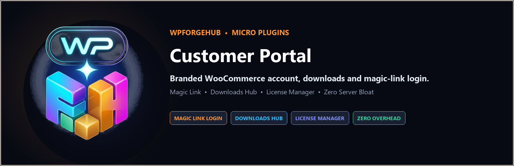

# ForgeHub Customer Portal

  

  
  

> ⚡ **Modern, high-performance customer dashboard for WooCommerce digital products. Features 1-click passwordless Magic Link login, clean Downloads (.zip) manager, license management, and instant post-checkout redirect.**

---

## ⚡ Features

### Free Community Edition
- **SaaS-Grade My Account Area:** Replaces legacy WooCommerce account layout with an ultra-responsive, sleek dashboard.
- **1-Click Magic Link Authentication:** Let customers sign in without typing passwords via secure cryptographic email links.
- **Digital Downloads Hub:** High-clarity download cards with version numbers, file sizes, and instant download buttons.
- **Order & Purchases History:** Clean view of customer orders and fulfillment statuses.
- **Profile & Password Controls:** Customers can update their details and set/change passwords without confusion.
- **Automated Post-Checkout Routing:** Instantly guides buyers to their files upon checkout completion.

### Pro Edition
- **Priority Support Ticket Desk:** Database-backed ticket management with status badges, threaded conversations, SLA prioritization, and file attachments.
- **Domain License Delegation & Remote Deactivation:** View active website domains per license key and remotely deactivate staging/client domains in 1-click.
- **Automated Compliant PDF Invoices:** Printable and downloadable tax invoices with EU VAT numbers, tax calculations, and license keys.
- **Brand Customization:** Match your store's custom accent colors and dark/light themes.

---

## 📊 Free vs Pro Comparison

| Feature | Community Free | Pro Commercial |
| :--- | :---: | :---: |
| Responsive SaaS Account Dashboard | ✅ | ✅ |
| Passwordless Magic Link Login | ✅ | ✅ |
| Digital .zip Downloads Manager | ✅ | ✅ |
| Instant Order & License View | ✅ | ✅ |
| Priority Support Ticket Desk | ❌ | ✅ |
| Domain Seat Activation & Remote Deactivation | ❌ | ✅ |
| Automated Tax Invoices (PDF & Print) | ❌ | ✅ |
| Custom Accent Colors & Themes | ❌ | ✅ |

---

## 🛠️ Installation

1. Upload the `forgehub-customer-portal` folder to `/wp-content/plugins/`.
2. Activate the plugin through the **Plugins** menu in WordPress.
3. Navigate to **WooCommerce -> Customer Portal** to configure settings.

---

## 🔒 Security & Privacy

- Cryptographic 24-byte random tokens hashed via SHA-256 for magic links.
- 15-minute transient expiry with instant one-time token invalidation.
- Zero external dependencies and zero tracking overhead.

---

## 📄 License

GPLv2 or later. See [license.txt](license.txt) for details.
